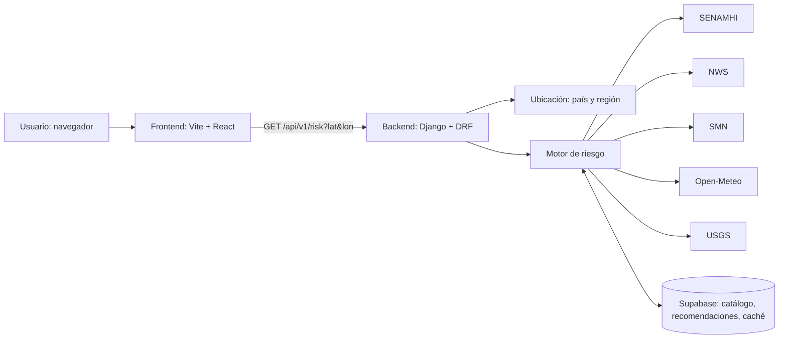
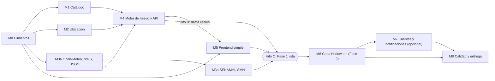

# 👻 Hauntcast Weather

> **Las alertas de desastres naturales de tu ubicación, contadas por los espíritus.**
> Si se viene una lluvia fuerte, un huayco o una ola de calor donde estás, Hauntcast te avisa,
> te muestra qué tan grave es con una escala de calaveras y te dice qué hacer, paso a paso.

Proyecto para **Kiroween 2026** (Devpost · Kiro · AWS), categoría **Costume Contest**.
Entrega: **viernes 4 de diciembre de 2026, 5:00 pm hora Perú**.

Equipo: **Gabriel** y **Luciana**.

> ⚠️ Este README está en español para el equipo. Antes de entregar hay que traducirlo al inglés
> (las reglas piden todo en inglés). Está en el módulo M8.

---

## Índice

1. [La idea](#1-la-idea)
2. [Cómo funciona para el usuario](#2-cómo-funciona-para-el-usuario)
3. [Fuentes de datos](#3-fuentes-de-datos)
4. [Catálogo de peligros](#4-catálogo-de-peligros)
5. [La Escala de Calaveras](#5-la-escala-de-calaveras)
6. [La capa Halloween](#6-la-capa-halloween)
7. [Arquitectura](#7-arquitectura)
8. [Contrato de la API](#8-contrato-de-la-api)
9. [Base de datos (Supabase)](#9-base-de-datos-supabase)
10. [Usuarios y administración](#10-usuarios-y-administración)
11. [Módulos](#11-módulos)
12. [Orden y dependencias](#12-orden-y-dependencias)
13. [Cronograma](#13-cronograma)
14. [Cómo trabajamos en GitHub](#14-cómo-trabajamos-en-github)
15. [Cómo usamos Kiro](#15-cómo-usamos-kiro)
16. [Pendientes del código actual](#16-pendientes-del-código-actual)
17. [Checklist de la hackatón](#17-checklist-de-la-hackatón)

---

## 1. La idea

### El problema

Los avisos oficiales de desastres existen, pero casi nadie los ve a tiempo:

- Están repartidos en páginas distintas por país (SENAMHI en Perú, NWS en Estados Unidos, SMN en México).
- Se publican como mapas técnicos o boletines en PDF, no como "**esto te afecta a ti, ahora**".
- Dicen qué pasa, pero casi nunca **qué hacer** de forma clara y en el momento.

### La solución

Una app web que:

1. **Detecta dónde estás, en tiempo real** (o la ciudad que busques).
2. **Consulta la fuente oficial de tu país**, o una fuente global si no hay una oficial integrada.
3. **Te dice si hay un peligro activo o pronosticado** cerca de ti: lluvias fuertes, huaycos, inundaciones,
   heladas, olas de calor, sismos, huracanes y más ([lista completa](#4-catálogo-de-peligros)).
4. **Te explica qué tan grave es** con la [Escala de Calaveras](#5-la-escala-de-calaveras), del 0 al 4.
5. **Te dice qué hacer antes, durante y después**, con recomendaciones de fuentes oficiales.

### Por qué el terror *ayuda* (y no es solo decoración)

La categoría Costume Contest pide que el diseño spooky **mejore la función**. Aquí lo hace:

- **El nivel de peligro se entiende de un vistazo.** Un fantasma dormido es "tranquilo"; la Parca es "actúa ya".
  Una calavera se recuerda más que "aviso nivel 3".
- **Cada peligro tiene su animación que lo explica.** Un esqueleto arrastrado por un huayco enseña mejor que un
  párrafo por qué no hay que cruzar una quebrada cuando llueve.
- **El miedo se usa para prevenir, nunca para burlarse.** Los desastres son serios: el texto de qué hacer siempre es
  claro, va primero y no depende de la animación ([principios](#principios-de-diseño-no-negociables)).

---

## 2. Cómo funciona para el usuario

```
1. Abre la app  ─►  "¿Nos dejas ver dónde estás?"  (o busca una ciudad)
2. Pantalla principal:
      ☠️  NIVEL 3 · PELIGRO          Arequipa, Perú
      Huayco · Aviso oficial SENAMHI · vigente hasta mañana 7:00 am
      [ animación del huayco ]
      QUÉ HACER AHORA
      • Aléjate de quebradas y cauces secos ...
3. Toca una alerta  ─►  detalle: qué es, de dónde sale el dato, antes / durante / después
4. Sin alertas  ─►  "Calma en el cementerio" + pronóstico de los próximos días
5. (Opcional, con cuenta) Guarda tus lugares y recibe avisos  ─►  módulo M7
```

- **Sigue tu ubicación en tiempo real** mientras la app está abierta. Si te mueves más de ~1 km, vuelve a consultar
  las alertas, y si el nivel sube te avisa en pantalla.
- **Funciona sin cuenta.** Los jueces y cualquier persona deben poder usarla al instante.
- **Siempre muestra la fuente** y la hora del dato. Distingue entre **aviso oficial** y **riesgo estimado**
  (ver abajo).

---

## 3. Fuentes de datos

Hay dos tipos de alerta, y la app **siempre** dice cuál es cuál:

| Tipo | Qué es | Ejemplo |
|---|---|---|
| 🏛️ **Aviso oficial** | Lo emite el servicio meteorológico del país | "Aviso SENAMHI Nivel 3: lluvias de moderada a fuerte intensidad" |
| 🔮 **Riesgo estimado** | Lo calcula Hauntcast con un pronóstico y umbrales propios | "Se pronostican ráfagas de 70 km/h mañana" |

### Fuentes por país

| País | Fuente | Qué da | Cómo se consulta | Notas |
|---|---|---|---|---|
| 🇵🇪 Perú | **SENAMHI** (vía GeoSINPAD de INDECI) | Avisos oficiales de 24 h: **precipitación**, **activación de quebradas (huaycos)**, **hidrológicos (ríos)** y **riesgo de incendio (FWI)** | ArcGIS REST, consulta por punto, responde JSON o GeoJSON | Verificado el 21/11/2026. Trae `NIVEL`, `DESCRIPCIO` y **`RECOMENDAC` (recomendación oficial)** |
| 🇺🇸 EE. UU. | **NWS** (National Weather Service) | Todas las alertas oficiales activas: tornados, inundaciones, huracanes, calor, nieve, incendios, tsunamis... | `GET https://api.weather.gov/alerts/active?point={lat},{lon}` | Gratis, sin clave. **Exige un header `User-Agent`** que identifique la app |
| 🇲🇽 México | **SMN** (Conagua) | **Pronóstico** por municipio (diario y por hora a 48 h). No trae avisos en JSON | `GET https://smn.conagua.gob.mx/tools/GUI/webservices/?method=1` (diario) o `method=3` (48 h) | Devuelve **todo el país** en un JSON comprimido (gzip), con lat/lon por municipio: se descarga 1 vez por hora y se busca el municipio más cercano. Da **riesgo estimado** |
| 🌎 Resto del mundo | **Open-Meteo** | Pronóstico global: lluvia, viento, ráfagas, temperatura, UV, nieve, visibilidad, tormentas | `GET https://api.open-meteo.com/v1/forecast` | Gratis, sin clave, uso no comercial. Da **riesgo estimado**. También sirve de **respaldo** si una fuente oficial falla |

**Detalle de SENAMHI** (servicio `Ent_Tecnico_Cientificas/SENAMHI/MapServer` en `geosinpad.indeci.gob.pe`):

| Capa | Nombre | Peligro | Geometría | Campos clave |
|---|---|---|---|---|
| 2 | `SENAMHI_AvisoActQuebrada24H` | Huaycos / activación de quebradas | Polígonos por distrito | `NIVEL` ("Nivel 1"…"Nivel 4"), `DESCRIPCIO`, `RECOMENDAC`, `NOMBDEP`, `NOMBPROV`, `NOMBDIST` |
| 3 | `SENAMHI_AvisoFWI24H` | Riesgo de incendio forestal | Polígonos | `RANGO`, `INTENSIDAD` |
| 4 | `SENAMHI_AvisoHidrologico24H` | Crecida de ríos | **Puntos** (estaciones) | `NIVEL` (número), `COLOR_TEXT`, `TITULO`, `PELIGRO_NI`, `RECOMENDAC`, `NOM_CUENCA` |
| 5 | `SENAMHI_AvisoPP24H` | Lluvias intensas | Polígonos | `NIVEL` ("Nivel 1"…"Nivel 4"), `DESCRIPCIO`, `RECOMENDAC` |

Ejemplo de consulta por punto (capa 5, Arequipa):

```
https://geosinpad.indeci.gob.pe/indeci/rest/services/Ent_Tecnico_Cientificas/SENAMHI/MapServer/5/query
  ?geometry=-71.537,-16.409&geometryType=esriGeometryPoint&inSR=4326
  &spatialRel=esriSpatialRelIntersects&outFields=*&returnGeometry=false&f=json
```

> ⚠️ **Ojo con la capa hidrológica:** su `NIVEL` usa otra escala (1 = amarillo, 2 = naranja).
> Hay que mapearla por `COLOR_TEXT`, no por el número.
>
> ⚠️ **Riesgo conocido:** hay reportes de que los servidores de SENAMHI no siempre responden desde la nube.
> Por eso el despliegue se prueba **temprano** (M0) y Open-Meteo queda como respaldo.
>
> SENAMHI también tiene una API de interoperabilidad propia, pero pide clave. Queda como alternativa.

### Fuentes extra (sugeridas)

| Fuente | Para qué | Cómo |
|---|---|---|
| **USGS** | Sismos recientes cerca, en todo el mundo (clave para Perú) | `GET https://earthquake.usgs.gov/fdsnws/event/1/query?format=geojson&latitude=..&longitude=..&maxradiuskm=300&minmagnitude=4.5&starttime=..` |
| **Open-Meteo Flood API** | Caudal de ríos pronosticado (inundaciones) en todo el mundo | `GET https://flood-api.open-meteo.com/v1/flood` |
| **Open-Meteo Geocoding** | Buscar una ciudad por nombre | `GET https://geocoding-api.open-meteo.com/v1/search?name=..` |
| **Nominatim (OpenStreetMap)** | Saber el país y la región a partir de coordenadas | Máximo 1 consulta por segundo, `User-Agent` propio y cachear resultados |
| **GDACS** (ONU y Comisión Europea) | Eventos globales: sismos, ciclones, inundaciones, volcanes, sequías | API GeoJSON sin clave ([quickstart](https://data.gdacs.org/Documents/2025/GDACS_API_quickstart_v1.pdf)) |

### Reglas para todas las fuentes

- **Cachear siempre.** Nunca llamar a una fuente en cada visita: guardar el resultado unos 10–15 minutos,
  agrupando coordenadas cercanas (por ejemplo, redondeadas a 0.05°).
- **Si una fuente falla, se dice.** "SENAMHI no responde, mostrando riesgo estimado." Nunca mostrar "todo tranquilo"
  porque no llegó el dato.
- **User-Agent identificable** en NWS y Nominatim, por ejemplo `Hauntcast-Weather (github.com/Rambiku/Hauntcast-Weather)`.

---

## 4. Catálogo de peligros

Cada peligro tiene un **slug fijo** (el identificador que usan backend, frontend y animaciones).
**Los slugs no se cambian sin acuerdo de los dos.** MVP = lo que entra sí o sí para la demo.

### 🌧️ Agua

| Slug | Peligro | Fuentes | MVP |
|---|---|---|---|
| `lluvia_intensa` | Lluvias intensas | SENAMHI (capa 5), NWS, SMN, Open-Meteo | ✅ |
| `huayco` | Huaycos y activación de quebradas | SENAMHI (capa 2) | ✅ |
| `inundacion` | Inundaciones y desborde de ríos | SENAMHI (capa 4), NWS, Open-Meteo Flood | ✅ |
| `tormenta_electrica` | Tormentas eléctricas | NWS, Open-Meteo (`weather_code` 95–99) | ✅ |
| `granizo` | Granizo | NWS, Open-Meteo (`weather_code` 96 y 99) | |
| `deslizamiento` | Deslizamientos de tierra | NWS, estimado por lluvia acumulada | |

### 🌡️ Frío y calor

| Slug | Peligro | Fuentes | MVP |
|---|---|---|---|
| `helada` | Heladas | NWS, Open-Meteo (temperatura mínima), SMN | ✅ |
| `ola_calor` | Olas de calor y temperaturas extremas | NWS, Open-Meteo, SMN | ✅ |
| `radiacion_uv` | Radiación UV extrema | Open-Meteo (`uv_index`) | ✅ |
| `nevada` | Nevadas y ventiscas | NWS, Open-Meteo (`snowfall`) | |
| `friaje` | Friaje (selva peruana) | Estimado con Open-Meteo | |

### 🌪️ Viento y mar

| Slug | Peligro | Fuentes | MVP |
|---|---|---|---|
| `viento_fuerte` | Vientos y ráfagas fuertes | NWS, Open-Meteo (`wind_gusts_10m`), SMN | ✅ |
| `ciclon_tropical` | Huracanes y ciclones tropicales | NWS, GDACS | ✅ |
| `tornado` | Tornados | NWS | ✅ |
| `oleaje` | Oleaje anómalo y marejadas | NWS, Open-Meteo Marine | |
| `tsunami` | Tsunamis | NWS | |

### 🌋 Tierra, fuego y aire

| Slug | Peligro | Fuentes | MVP |
|---|---|---|---|
| `sismo` | Sismos recientes | USGS | ✅ |
| `incendio_forestal` | Riesgo de incendio forestal | SENAMHI (capa 3), NWS, GDACS | |
| `volcan` | Actividad volcánica y caída de ceniza | NWS, GDACS | |
| `niebla` | Neblina densa | NWS, Open-Meteo (`visibility`) | |
| `polvo` | Tormentas de polvo y arena | NWS, estimado por viento | |
| `calidad_aire` | Mala calidad del aire o humo | Open-Meteo Air Quality | |
| `sequia` | Sequía | GDACS | |

### Recomendaciones

Para **cada peligro** guardamos qué hacer **antes**, **durante** y **después**, con su fuente:

- 🇵🇪 **INDECI** y **CENEPRED**
- 🇺🇸 **Ready.gov** y **FEMA**
- 🇲🇽 **CENAPRED** y **Protección Civil**

Si el aviso oficial trae su propia recomendación (SENAMHI tiene `RECOMENDAC`), **esa va primero**.
También guardamos los **números de emergencia por país**, verificados en fuentes oficiales.

---

## 5. La Escala de Calaveras

Todas las fuentes usan escalas distintas. Hauntcast las convierte a **una sola escala del 0 al 4**.
El color oficial se mantiene, así que el nivel se entiende **por color, ícono y texto a la vez**
(accesible para daltónicos).

En la **Fase 1** el nivel se muestra simple (número, color y texto). Las calaveras llegan en la **Fase 2**.

| Nivel | Nombre | Indicador spooky (Fase 2) | Color | SENAMHI | NWS (`severity`) |
|---|---|---|---|---|---|
| 0 | **Calma** | 🕯️ Fantasma dormido | Morado | Sin aviso | Sin alertas |
| 1 | **Atento** | 🎃 Calabaza encendida | Verde | Nivel 1 | Minor |
| 2 | **Precaución** | 👻 Fantasma inquieto | Amarillo | Nivel 2 | Moderate · Unknown |
| 3 | **Peligro** | 💀 Esqueleto | Naranja | Nivel 3 | Severe |
| 4 | **Extremo** | ☠️ La Parca | Rojo | Nivel 4 | Extreme |

Reglas de la escala (buenas candidatas para *property-based testing*, ver [Kiro](#15-cómo-usamos-kiro)):

- El resultado **siempre** es un entero del 0 al 4.
- El **nivel general** de un lugar es el **máximo** de sus alertas activas.
- Un dato desconocido o mal formado **nunca baja el riesgo**: se trata como nivel 2.
- Un **riesgo estimado** llega como máximo a nivel 3. El 4 se reserva para avisos oficiales.
- Los umbrales del riesgo estimado se definen en la spec del módulo M3. Por ejemplo, la escala de la OMS
  marca el índice UV de 8 a 10 como "muy alto" y de 11 en adelante como "extremo".

---

## 6. La capa Halloween

> Esto es la **Fase 2**. Primero la app funciona con una UI simple (Fase 1) y después diseñamos esta capa
> **los dos juntos**. Esta sección es una guía de ideas, no algo cerrado.

### Qué lleva

- **Animación por peligro** (la hacemos nosotros): una escena corta que explica el peligro. Por ejemplo, un esqueleto
  que intenta cruzar una quebrada y se lo lleva el huayco, o un fantasma que tirita en una helada.
- **Indicador de la Escala de Calaveras**, grande y siempre visible.
- **Ambiente:** fondo de cementerio de noche que cambia con el clima real (lluvia, niebla, viento) y
  textos con humor negro **solo cuando el nivel es 0 o 1**.

### Contrato para las animaciones

Para que la animación y el código avancen por separado:

- Un solo componente: `<HazardScene hazard="huayco" level={3} />`. En la Fase 1 ya existe, pero solo muestra un ícono.
- Archivos en `frontend/src/animations/<slug>/`. Formato a decidir en M6: Lottie (JSON), SVG animado o video `webm`.
- **Si no existe la animación de un peligro, se muestra una ilustración fija.** La app nunca se rompe por una
  animación faltante.
- Duración de 5 a 10 segundos, en bucle, y cada una con un **texto alternativo** que explique lo mismo.

### Principios de diseño (no negociables)

1. **Lo que hay que hacer va primero.** En nivel 3 o 4, el bloque "Qué hacer ahora" aparece **antes** que la animación.
2. **Modo calma.** Un botón para apagar animaciones y efectos. Se activa solo si el sistema pide menos movimiento
   (`prefers-reduced-motion`).
3. **Nada de burlas.** Los esqueletos explican y advierten, no se ríen de víctimas reales. En nivel 3 o 4 no hay chistes.
4. **Legible primero.** Buen contraste, tipografía clara para los textos importantes y la fuente decorativa solo en títulos.

---

## 7. Arquitectura



| Capa | Tecnología | Estado |
|---|---|---|
| Backend | Django 6.1 + Django REST Framework + django-cors-headers | ✅ Creado (estructura) |
| Base de datos | Supabase (Postgres) vía `supabase-py` | ✅ Conectado, tablas creadas |
| Frontend | Vite + React (el CORS ya apunta a `localhost:5173`) | ⏳ Por crear (M5) |
| Despliegue | Backend en Render, Railway o AWS; frontend en Vercel, Netlify o AWS Amplify | ⏳ M0 y M8 |

### Estructura del repo (actual + lo que falta)

```
Hauntcast-Weather/
├── .kiro/                         OBLIGATORIO para la hackatón
│   ├── steering/                  ✅ product.md · tech.md · structure.md · hazards.md · workflow.md
│   ├── specs/<modulo>/            ⏳ requirements.md · design.md · tasks.md (una por módulo)
│   └── hooks/                     ⏳
├── apps/                          ✅ Apps de Django (una por dominio)
│   ├── users/                     profiles, user_locations
│   ├── locations/                 countries, locations
│   ├── weather/                   weather_categories, weather_observations
│   ├── alerts/                    weather_alerts
│   ├── recommendations/           prevention_recommendations
│   └── notifications/             notifications
├── config/                        ✅ settings, urls
├── core/                          ✅ Cliente de Supabase + repositorio CRUD base
├── integrations/
│   └── weather_providers/
│       ├── base.py                ⏳ Interfaz común (vacía)
│       ├── senamhi.py             ⏳
│       ├── nws.py                 ⏳
│       ├── smn.py                 ⏳
│       ├── open_meteo.py          ⏳
│       └── usgs.py                ⏳
├── services/
│   ├── alert_engine.py            ⏳ Motor de riesgo (vacío)
│   ├── risk_scale.py              ⏳ Escala de Calaveras
│   └── notification_service.py    ⏳ (vacío)
├── supabase/                      ⏳ schema.sql + seeds (catálogo y recomendaciones)
├── frontend/                      ⏳ App Vite + React
├── docs/                          ⏳ api-contract.md · bitacora-kiro.md
├── requirements.txt               ⏳
├── .env.example                   ⏳
└── LICENSE                        ⏳ MIT (obligatorio)
```

---

## 8. Contrato de la API

Este contrato es **lo que permite trabajar en paralelo**: el frontend avanza con datos de prueba (mocks)
que siguen esta forma, mientras el backend construye los proveedores. Se fija en M0 y se versiona en
`docs/api-contract.md`. **Cambiarlo requiere PR aprobado por los dos.**

### Endpoints

| Método | Ruta | Qué devuelve | Módulo |
|---|---|---|---|
| GET | `/api/v1/risk?lat=&lon=` | Nivel general, alertas activas y recomendaciones del lugar | M4 |
| GET | `/api/v1/locations/resolve?lat=&lon=` | País, región y ciudad de unas coordenadas | M2 |
| GET | `/api/v1/locations/search?q=` | Ciudades que coinciden con el texto | M2 |
| GET | `/api/v1/hazards` | Catálogo de peligros (slug, nombre, categoría) | M1 |
| GET | `/api/v1/recommendations?hazard=&country=` | Qué hacer antes, durante y después | M1 |

### Forma de `/api/v1/risk`

```json
{
  "location": { "lat": -16.409, "lon": -71.537, "country_code": "PE", "region": "Arequipa", "city": "Arequipa" },
  "overall_level": 3,
  "updated_at": "2026-11-21T14:00:00Z",
  "sources_status": [
    { "source": "senamhi", "ok": true },
    { "source": "open_meteo", "ok": true }
  ],
  "alerts": [
    {
      "id": "senamhi-quebrada-12345",
      "hazard": "huayco",
      "level": 3,
      "kind": "official",
      "source": "senamhi",
      "title": "Activación de quebradas",
      "description": "Ante el pronóstico de lluvias es probable la activación de quebradas...",
      "official_recommendation": "Estar atentos a la información oficial...",
      "area_name": "Arequipa / Arequipa / Cayma",
      "starts_at": "2026-11-21T12:00:00Z",
      "ends_at": "2026-11-22T12:00:00Z",
      "source_url": "https://www.senamhi.gob.pe/"
    }
  ],
  "recommendations": {
    "huayco": {
      "before": ["..."],
      "during": ["..."],
      "after": ["..."],
      "source": "INDECI"
    }
  },
  "emergency_numbers": [ { "label": "Bomberos", "number": "116" } ]
}
```

- `kind` es `official` (aviso oficial) o `estimated` (riesgo estimado).
- `level` y `overall_level` siempre van del 0 al 4 ([escala](#5-la-escala-de-calaveras)).
- Fechas en UTC (ISO 8601). El frontend las muestra en hora local.

### Interfaz común de proveedores (`integrations/weather_providers/base.py`)

Cada fuente implementa lo mismo y devuelve alertas ya normalizadas:

```python
class WeatherProvider(Protocol):
    name: str                       # "senamhi", "nws", ...
    def covers(self, country_code: str) -> bool: ...
    def fetch_alerts(self, lat: float, lon: float) -> list[HazardAlert]: ...
```

El motor elige los proveedores según el país: Perú → SENAMHI + Open-Meteo + USGS; EE. UU. → NWS + USGS;
México → SMN + Open-Meteo + USGS; otros → Open-Meteo + USGS. Junta los resultados, quita duplicados
y calcula el nivel general.

---

## 9. Base de datos (Supabase)

Tablas que **ya existen** (el esquema completo hay que exportarlo a `supabase/schema.sql` en M0, para que esté
en el repo y Kiro lo pueda leer):

| Tabla | Para qué | Repositorio en el código |
|---|---|---|
| `countries` | Países soportados y su fuente principal | `apps/locations` |
| `locations` | Lugares (ciudad, región, coordenadas) | `apps/locations` |
| `weather_categories` | **Catálogo de peligros** (`code`, `name`, `description`, `animation_key`) | `apps/weather` |
| `weather_observations` | Datos de pronóstico guardados (caché) | `apps/weather` |
| `weather_alerts` | Alertas normalizadas (caché e historial) | `apps/alerts` |
| `prevention_recommendations` | Recomendaciones por peligro y país — una fila por acción (`category_id`, `severity`, `title`, `description`) | `apps/recommendations` |
| `profiles` | Perfil de usuario (opcional) | `apps/users` |
| `user_locations` | Lugares guardados por un usuario | `apps/users` |
| `notifications` | Avisos enviados a usuarios | `apps/notifications` |

**Seguridad:** la `SUPABASE_KEY` del backend (clave `service_role`) **nunca** va al frontend ni al repo.
Si el frontend usa Supabase Auth, usa la clave pública `anon` con *Row Level Security* activado.

---

## 10. Usuarios y administración

**Decisión: no hacemos panel de administración ni roles de admin.**

- **La app funciona sin cuenta.** Es lo más importante para la demo y para los jueces.
- **El contenido** (catálogo, recomendaciones, números de emergencia) se carga con archivos SQL en
  `supabase/` (versionados en el repo) y se edita desde el panel de Supabase. **Supabase ya es nuestro "admin"**;
  construir otro no suma puntos.
- **La cuenta es opcional** y solo sirve para guardar lugares y recibir notificaciones (M7). Se hace con
  **Supabase Auth**.
- Como hoy no hay base de datos de Django (`DATABASES = {}`), el `/admin` de Django no funciona. En M0 se quita
  (ver [pendientes](#16-pendientes-del-código-actual)).

---

## 11. Módulos

El trabajo va en **dos fases**:

- **Fase 1 · Que funcione:** la app completa con una **UI simple y limpia**, sin nada de Halloween todavía.
  Módulos M0 a M5.
- **Fase 2 · Que asuste:** la capa Halloween, que diseñamos **los dos juntos** sobre la app que ya funciona. Módulo M6.

Después vienen M7 (opcional) y M8 (entrega).

### Los módulos en palabras simples

| Módulo | Qué es |
|---|---|
| **M0 Cimientos** | Dejar el proyecto listo para que los dos trabajen sin pisarse. Se hace **una sola vez**, al inicio |
| **M1 Catálogo** | La **lista de fenómenos** (los 23 peligros) y, para cada uno, **qué hacer** antes, durante y después. Es el contenido de la app |
| **M2 Ubicación** | Saber **dónde está el usuario en tiempo real** y de qué país y región es, para elegir la fuente correcta |
| **M3 Proveedores** | Las **fuentes de datos** (SENAMHI, NWS, SMN, Open-Meteo, USGS). Cada proveedor es un "traductor": trae los datos de su fuente y los convierte al mismo formato |
| **M4 Motor de riesgo** | El **cerebro**: junta lo que dicen las fuentes, quita repetidos y calcula el nivel del 0 al 4 |
| **M5 Frontend simple** | Las pantallas de la app con una UI sencilla. Lo hacemos **los dos** |
| **M6 Capa Halloween** | El disfraz: escala de calaveras, animaciones y ambiente. Lo hacemos **los dos juntos** |
| **M7 Cuentas y notificaciones** | Opcional: guardar lugares y recibir avisos con la app cerrada |
| **M8 Calidad y entrega** | Pruebas, despliegue, video y todo lo que pide Devpost |

Cada módulo tiene un **dueño**, lo que **necesita** para empezar y una **definición de "listo"**.
Lo que sí se repite en **cada** módulo: crear su spec en Kiro, trabajar en su rama y entrar por PR
([sección 14](#14-cómo-trabajamos-en-github) y [sección 15](#15-cómo-usamos-kiro)).

## Fase 1 · Que funcione

### M0 · Cimientos — *Gabriel (backend) + Luciana (frontend)* · 🔒 bloquea todo

**Objetivo:** que los dos puedan trabajar en paralelo sin pisarse. Se hace una sola vez.

- [ ] `requirements.txt`, `.env.example`, `LICENSE` (MIT) y arreglos de [pendientes](#16-pendientes-del-código-actual).
- [ ] Exportar el esquema de Supabase a `supabase/schema.sql`.
- [x] Carpeta `.kiro/steering/` con `product.md`, `tech.md`, `structure.md`, `hazards.md` y `workflow.md` (salen de este README).
- [ ] `docs/api-contract.md` con el [contrato](#8-contrato-de-la-api) y la lista de slugs **congelada**.
- [ ] `integrations/weather_providers/base.py` con la interfaz y el modelo `HazardAlert`.
- [ ] `frontend/` creado con Vite + React y un `mocks/risk.json` que sigue el contrato.
- [ ] **Despliegue de prueba** del backend: comprobar que desde la nube responden SENAMHI (INDECI) y NWS.

**Listo cuando:** los dos pueden levantar el proyecto con el README, el frontend muestra el mock y el contrato está aprobado.

### M1 · Catálogo de fenómenos y recomendaciones — *Luciana* · necesita M0

- [ ] Llenar `weather_categories` con los 23 peligros del [catálogo](#4-catálogo-de-peligros) (`supabase/seed_hazards.sql`).
- [ ] Llenar `prevention_recommendations`: antes, durante y después para **todos los peligros MVP**, en Perú,
  EE. UU. y México, con la fuente de cada uno (`supabase/seed_recommendations.sql`).
- [ ] Números de emergencia por país, verificados.
- [ ] Endpoints `GET /api/v1/hazards` y `GET /api/v1/recommendations`.

**Listo cuando:** los endpoints devuelven datos reales y cada recomendación tiene su fuente.

### M2 · Ubicación en tiempo real — *Gabriel (backend); la parte del navegador va en M5* · necesita M0

- [ ] `GET /api/v1/locations/resolve`: coordenadas → país, región y ciudad (Nominatim, con caché).
- [ ] `GET /api/v1/locations/search`: búsqueda de ciudades (Open-Meteo Geocoding), para quien no da permiso de ubicación.
- [ ] Guardar lugares resueltos en `locations` para no repetir consultas.
- [ ] En el navegador (se hace dentro de M5): seguir la ubicación con `navigator.geolocation.watchPosition` y volver a
  consultar `/api/v1/risk` **solo** si la persona se movió más de ~1 km o pasaron 10 minutos, para no saturar las fuentes.

> "Tiempo real" funciona **mientras la app está abierta**. Con la app cerrada el navegador no comparte la ubicación;
> los avisos en segundo plano son parte de M7.

**Listo cuando:** Arequipa, Lima, Miami y Ciudad de México se resuelven bien, incluso con la caché.

### M3 · Proveedores de datos — *Gabriel* · necesita M0

Va en dos partes, en este orden. Lo **global** primero garantiza que la demo funcione en cualquier lugar.

**M3a (primero):**
- [ ] `open_meteo.py`: pronóstico → riesgos estimados con umbrales (lluvia, viento, helada, calor, UV, tormenta).
- [ ] `nws.py`: alertas oficiales de EE. UU. → slug + nivel.
- [ ] `usgs.py`: sismos recientes cerca.

**M3b (después):**
- [ ] `senamhi.py`: las 4 capas de GeoSINPAD → slug + nivel (cuidado con la escala de la capa hidrológica).
- [ ] `smn.py`: pronóstico por municipio → riesgos estimados.
- [ ] (Opcional) `gdacs.py`.

**Listo cuando:** cada proveedor tiene pruebas con respuestas reales guardadas (fixtures) y devuelve `HazardAlert` válidos.

### M4 · Motor de riesgo y API — *Gabriel* · necesita M2 + M3a + slugs de M1

- [ ] `services/risk_scale.py`: conversión de cada fuente a la Escala de Calaveras.
- [ ] `services/alert_engine.py`: elige proveedores por país, junta, quita duplicados, calcula el nivel general
  y maneja fuentes caídas (`sources_status`).
- [ ] Caché en `weather_alerts` y `weather_observations` (10–15 min).
- [ ] `GET /api/v1/risk` completo, con recomendaciones y números de emergencia.

**Listo cuando:** `/api/v1/risk` responde en menos de 3 segundos con caché, para Perú, EE. UU., México y otro país.
🚩 **Hito B:** desde aquí el frontend deja los mocks y usa datos reales.

### M5 · Frontend simple — *los dos* · necesita M0

UI **sencilla y limpia**, sin estilo Halloween. Lo importante es que todo funcione.

- [ ] Estructura del proyecto (Vite + React), rutas y cliente de la API.
- [ ] Ubicación en tiempo real (`watchPosition`), con búsqueda de ciudad si no hay permiso.
- [ ] Pantalla principal: nivel (número, color y texto), alertas y "Qué hacer ahora".
- [ ] Detalle de alerta: descripción, fuente, antes, durante y después.
- [ ] Aviso en pantalla si el nivel sube mientras la app está abierta.
- [ ] Estados vacíos y de error ("fuente caída", "sin conexión").
- [ ] Selector de idioma **inglés / español** (los jueces la usan en inglés).
- [ ] Primero con `mocks/risk.json`; después del Hito B, con la API real.
- [ ] **Dejar lista la Fase 2:** el nivel va en un componente `<RiskBadge level>` y la escena en `<HazardScene hazard level>`
  (por ahora solo un ícono). Así la capa Halloween **reemplaza componentes** en vez de rehacer pantallas.

**Reparto sugerido:** Luciana arranca con la estructura, la pantalla principal y la ubicación. Gabriel se suma al
terminar M4, conecta la API real y hace el detalle de alerta y los estados de error. Cada uno en **componentes
distintos** para no editar los mismos archivos.

**Listo cuando:** la app funciona con datos reales, en celular y escritorio.

### 🚩 Hito C · Fase 1 lista

App funcional con UI simple: Perú con SENAMHI real, EE. UU. con NWS real, el resto con Open-Meteo,
ubicación en tiempo real y recomendaciones. **Objetivo: sábado 28 de noviembre.**

## Fase 2 · Que asuste

### M6 · Capa Halloween — *los dos juntos* · necesita Hito C

- [ ] Definir juntos el estilo: paleta, tipografías y fondo de cementerio que cambia con el clima.
- [ ] `<RiskBadge>` pasa a ser la Escala de Calaveras (0 a 4).
- [ ] `<HazardScene>` pasa a mostrar las animaciones, con su ilustración fija de respaldo.
- [ ] Animaciones de los peligros MVP, empezando por: `huayco`, `lluvia_intensa`, `sismo`, `helada`, `ola_calor`.
- [ ] Modo calma y respeto de `prefers-reduced-motion`.

> Costume Contest se juzga sobre todo por la interfaz, y esta fase tiene pocos días. Si alguno termina antes su parte
> de la Fase 1, puede adelantar bocetos de animaciones.

**Listo cuando:** cada peligro MVP tiene animación o ilustración, y el modo calma funciona.

## Extras y entrega

### M7 · Cuentas y notificaciones — *Gabriel (backend) + Luciana (frontend)* · **opcional**

- [ ] Login opcional con Supabase Auth.
- [ ] Guardar lugares (`user_locations`).
- [ ] Avisar cuando un lugar guardado sube de nivel, aunque la app esté cerrada: notificación del navegador o correo
  (`notifications`).

**Solo si la Fase 2 está lista el martes 1 de diciembre.** Si no, se corta.

### M8 · Calidad y entrega — *los dos* · al final

- [ ] Pruebas: unitarias y *property-based* de la escala y los proveedores (ver [Kiro](#15-cómo-usamos-kiro)).
- [ ] Despliegue final con URL pública.
- [ ] README traducido al inglés, con instrucciones para correr el proyecto.
- [ ] Video de menos de 3 minutos en YouTube (sin música con copyright).
- [ ] Escrito de cómo usamos Kiro (sale de `docs/bitacora-kiro.md`).
- [ ] Post en blog y post en redes con `#KiroweenHackathon26` al inicio.

---

## 12. Orden y dependencias



**Qué tiene que terminar para que empiece otro:**

| Para empezar… | Tiene que estar listo… | Por qué |
|---|---|---|
| Todo | **M0** | Sin contrato ni slugs, cada uno inventaría su propio formato |
| M4 | M2, M3a y los slugs de M1 | El motor necesita saber el país, tener al menos una fuente y conocer el catálogo |
| M3b | M3a | SENAMHI y SMN copian el patrón ya probado con Open-Meteo y NWS |
| Datos reales en el frontend | **Hito B** (M4) | Antes de eso, el frontend usa mocks |
| M6 (Fase 2) | **Hito C** | La capa Halloween se monta sobre una app que ya funciona |
| M7 | M6 | Es opcional: solo si la Fase 2 ya está |

**Trabajo en paralelo:** después de M0, Gabriel va por backend (M2 → M3a → M4 → M3b) y Luciana por contenido y
pantallas (M1 → M5). Al llegar al Hito B, Gabriel se suma al frontend. La Fase 2 la hacen juntos.

---

## 13. Cronograma

| Fecha | Gabriel | Luciana | Hito |
|---|---|---|---|
| Sáb 21 – Dom 22 nov | M0 backend + despliegue de prueba | M0 frontend + mocks | 🚩 Hito A: M0 listo |
| Lun 23 – Mié 25 nov | M2 + M3a | M1 + M5 con mocks | |
| Jue 26 nov | M4 | M5 | 🚩 Hito B: `/api/v1/risk` real |
| Vie 27 – Sáb 28 nov | M3b (SENAMHI, SMN) + M5 con datos reales | M5 | 🚩 Hito C: Fase 1 lista |
| Dom 29 nov – Mar 1 dic | **M6 juntos** | **M6 juntos** | Fase 2 |
| Mié 2 dic | M7 si hay tiempo, o pulir | M7 si hay tiempo, o pulir | 🧊 Congelar funciones en la noche |
| Jue 3 dic | M8: despliegue final, README en inglés | M8: video, escrito de Kiro, blog y post | |
| **Vie 4 dic** | **Enviar en la mañana** | | ⏰ Cierre: 5:00 pm hora Perú |

Además: cada miembro pide sus **créditos de Kiro antes del martes 1 de diciembre a las 3:00 pm**.

---

## 14. Cómo trabajamos en GitHub

- **Un issue por módulo** (`M0 · Cimientos`, `M1 · Catálogo`...), con la checklist de su sección, y un
  **GitHub Project** con columnas *Por hacer / En curso / En revisión / Hecho*.
- **Una rama por tarea:** `m3/nws-provider`, `m5/pantalla-principal`, `m6/animacion-huayco`.
- **Nada directo a `main`:** todo entra por Pull Request y lo revisa la otra persona.
- **Commits claros:** `feat: proveedor NWS`, `fix: escala hidrológica SENAMHI`, `docs: contrato de la API`.
- **Para no generar conflictos:** el backend (`apps/`, `services/`, `integrations/`) lo lleva Gabriel. El `frontend/`
  es **compartido**, así que cada uno trabaja en **pantallas o componentes distintos** y lo avisan en el issue.
  **El contrato y los slugs** (`docs/api-contract.md`, `.kiro/steering/hazards.md`) solo cambian con PR aprobado por los dos.
- **Secretos fuera del repo:** el `.env` nunca se sube (ya está en `.gitignore`). Las claves se comparten por privado.
- **Nunca poner `.kiro/` en `.gitignore`**: descalifica.

---

## 15. Cómo usamos Kiro

El uso de Kiro vale **20% de la nota**, así que cada módulo debe lucir alguna función. Todo lo que hagan, anótenlo en
`docs/bitacora-kiro.md` (capturas, prompts que funcionaron, decisiones). De ahí sale el escrito final.

| Función de Kiro | Dónde la usamos |
|---|---|
| **Steering** | ✅ Ya creado en `.kiro/steering/` (en inglés, para que lo lean los jueces): `product.md` (la idea y sus principios), `tech.md` (stack, fuentes y reglas), `structure.md` (carpetas), `hazards.md` (slugs y escala) y `workflow.md` (Git y fases). Kiro los lee en cada respuesta |
| **Specs** | Una spec por módulo en `.kiro/specs/<modulo>/`: requisitos → diseño → tareas, a partir de la sección de este README |
| **Property-based testing** | Con Hypothesis en la escala y los proveedores: el nivel siempre está entre 0 y 4, el general es el máximo, un dato raro nunca baja el riesgo y quitar duplicados dos veces da lo mismo |
| **Agent hooks** | Correr `pytest` al guardar en `services/` o `integrations/`; regenerar los tipos del frontend cuando cambia `docs/api-contract.md`; revisar que cada recomendación nueva tenga fuente |
| **MCP** | Supabase (consultar el esquema y cargar seeds), navegador o Playwright (probar la interfaz) y GitHub (issues y PRs) |
| **Custom agents** | Un "revisor de accesibilidad" para el frontend y un "verificador de fuentes" para las recomendaciones |

### Cómo pedirle cosas a Kiro (para los prompts)

1. Abran el módulo que les toca en la [sección 11](#11-módulos) y pídanle a Kiro **una spec** con eso como base:
   *"Crea la spec del módulo M5 · Frontend simple según el README y el contrato en docs/api-contract.md"*.
2. Revisen y ajusten `requirements.md` y `design.md` **antes** de que Kiro implemente las tareas.
3. Pidan que implemente **tarea por tarea** y revisen cada una.
4. Si Kiro se desvía de una regla del proyecto, la regla va a `.kiro/steering/`, no solo al chat.

---

## 16. Pendientes del código actual

Lo que encontramos al revisar el commit inicial. Todo entra en **M0**.

| # | Pendiente | Qué hacer |
|---|---|---|
| 1 | No hay `requirements.txt` | Crearlo con django, djangorestframework, django-cors-headers, supabase, python-dotenv y httpx o requests |
| 2 | No hay `.env.example` y `core/supabase_client.py` falla al importar si faltan las claves | Crear `.env.example` con `SECRET_KEY`, `SUPABASE_URL` y `SUPABASE_KEY` (sin valores reales) |
| 3 | `DATABASES = {}` pero están instalados `admin`, `auth` y `sessions`, y existe la ruta `/admin` | Quitar `/admin` y esas apps, o usar SQLite solo para ellas. Recomendado: quitarlas y poner en DRF `DEFAULT_AUTHENTICATION_CLASSES: []` y `UNAUTHENTICATED_USER: None` |
| 4 | `CorsMiddleware` está al final de `MIDDLEWARE` | Moverlo lo más arriba posible, antes de `CommonMiddleware` (lo indica la documentación de django-cors-headers) |
| 5 | El esquema de Supabase no está en el repo | Exportarlo a `supabase/schema.sql` |
| 6 | `SupabaseRepository.create()` y `update()` encadenan `.select("*")` después de `insert` y `update` | Probarlo con la versión instalada de `supabase-py`: en Python, `insert` ya devuelve las filas, y ese encadenado puede fallar |
| 7 | `DEBUG = True` y `ALLOWED_HOSTS` solo local | Leerlos del `.env` para poder desplegar |
| 8 | Falta `LICENSE`, y en `.kiro/` faltan specs y hooks | `LICENSE` en M0; specs y hooks se crean con cada módulo |

---

## 17. Checklist de la hackatón

- [ ] Repo **público** en GitHub con **licencia open source** visible en "About".
- [ ] Carpeta **`/.kiro` en la raíz** (specs, hooks, steering) y **fuera** del `.gitignore`.
- [ ] App desplegada con **URL pública** que funcione **sin cuenta**.
- [ ] **Video de menos de 3 minutos**, público en YouTube.
- [ ] Descripción y **escrito de cómo usamos Kiro**.
- [ ] **Todo en inglés** (o traducido).
- [ ] Categoría: **Costume Contest**. Si los dos son estudiantes, marcar también **Best Student Project**.
- [ ] Post en blog y post en redes con `#KiroweenHackathon26` al inicio.
- [ ] Enviar el **jueves 3 o el viernes 4 en la mañana**.
